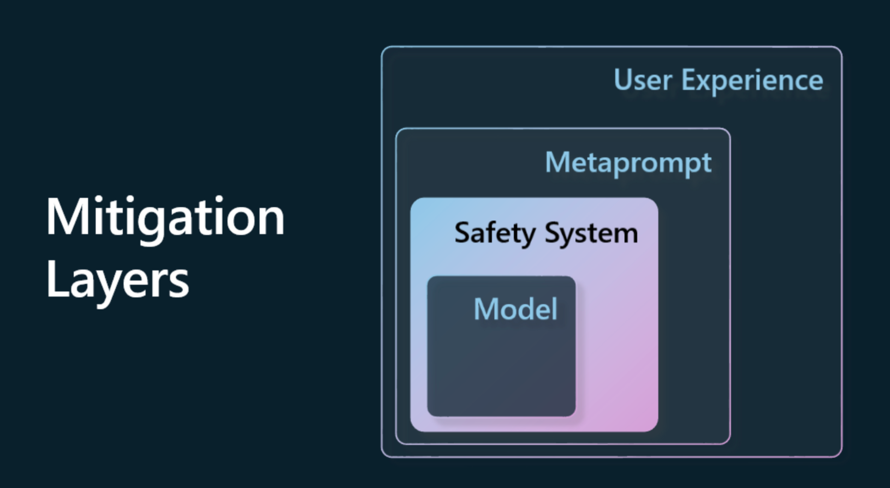

# Lecture
## 02-exploring-and-comparing-different-llms
* embeddings - convert text into a numerical form, make it easier for machines to understand the relationships between words or sentences and can be consumed as inputs by other models
* improve model performance on specific workloads 在特定工作流下提升模型表现的方法
  * Prompt engineering with context.
  * Retrieval Augmented Generation, RAG. Fetch the relevant data in a database or web endpoint for example and make that part of the user's prompt.
  * Fine-tuned model. Trained the model further on your own data.

## 03-using-generative-ai-responsibly
* prevent or limit the potential harm caused by the model and its responses, in 4 layers. 
  
* also, use RAG to have the model only pull information from a selection of trusted sources.
* design the UI/UX to limit the user inputs and infos displayed to the user.

## 04-prompt-engineering-fundamentals
* challenge problems of generative AI
  * randomization
  * fabrication
* methods
  * use open-source prompts library
* instruction prompt: give intention, with what response you need(maybe key dates and events), and format you want 指令
* primary content(e.g. give an article) 目标
  * give examples instead of telling the model what to do(zero-shot need explicit instruction, one-shot, few-shot)
  * give 'cues' like `summarize this`
* secondary content: tuning parameters, formatting instructions, topic taxonomies etc. 额外要求
* mindset
  * domain understanding
  * model understanding
  * iteration & validation
* `Best Practices` 技巧
    
| What                              | Why                                                                                                                                                                                                                                               |
| :-------------------------------- | :------------------------------------------------------------------------------------------------------------------------------------------------------------------------------------------------------------------------------------------------ |
| **`Evaluate the latest models.`**       | New model generations are likely to have improved features and quality - but may also incur higher costs. Evaluate them for impact, then make migration decisions.                                                                                |
| Separate instructions & context   | **`Check if your model/provider defines _delimiters_ to distinguish instructions, primary and secondary content more clearly.`** This can help models assign weights more accurately to tokens.                                                         |
| Be specific and clear             | **`Give more details about the desired context, outcome, length, format, style etc.`** This will improve both the quality and consistency of responses. Capture recipes in reusable templates.                                                          |
| Be descriptive, **`use examples`**      | Models may respond better to a "show and tell" approach. Start with a `zero-shot` approach where you give it an instruction (but no examples) then try `few-shot` as a refinement, providing a few examples of the desired output. Use analogies. |
| **`Use cues`** to jumpstart completions | Nudge it towards a desired outcome by giving it some leading words or phrases that it can use as a starting point for the response.                                                                                                               |
| Double Down                       | Sometimes you may need to repeat yourself to the model. **`Give instructions before and after your primary content`**, use an instruction and a cue, etc. Iterate & validate to see what works.                                                         |
| `Order` Matters                     | The order in which you present information to the model may impact the output, even in the learning examples, thanks to recency bias. Try different options to see what works best.                                                               |
| Give the model an “out”           | Give the model a _fallback_ completion response it can provide if it cannot complete the task for any reason. This can reduce chances of models generating false or fabricated responses.                                                         |
|                                   |                                                                                                                                                                                                                                                   |

# 05-advanced-prompts
* techniques
  * Zero-shot prompting, basic instruction
  * Few-shot prompting, with 1 or more examples
  * Chain-of-thought, tells the LLM how to break down a problem into steps 给LLM举栗子
  * Generated knowledge, using your own company's data 给它提供私有数据
  * Least to most, break down a bigger problem into subproblems 给LLM拆解问题
  * Self-refine, ask the LLM to critique itself 让LLM自我批评和改进
  * Maieutic prompting, ask the LLM to explain itself reduce inconsistencies
* temperature 控制随机性
* vary the output: top-k, top-p, repetition penalty, length penalty, diversity penalty
* practices
  * Specify context. Context matters, the more you can specify like domain, topic, etc. the better.
  * Limit the output. If you want a specific number of items or a specific length, specify it.
  * Specify both what and how. Remember to mention both what you want and how you want it, for example "Create a Python Web API with routes products and customers, divide it into 3 files".
  * Use templates. Often, you will want to enrich your prompts with data from your company. Use templates to do this. Templates can have variables that you replace with actual data.
  * Spell correctly. LLMs might provide you with a correct response, but if you spell correctly, you will get a better response.


# 06-text-generation-apps
* python lib `dotenv` 调用环境变量，隐藏 API 密钥
* 步骤
  * 创建 AI client
  * 部署
  * 设置 prompt 和 message（如设定身份）
  * 调用 API create completion
    * 和云端资源建立链接，发送prompt，接收结果


# 07-building-chat-applications
* user experience(UX)
  * Mechanism for addressing ambiguity 生成含混回答时让AI重新解释
  * Context retention, remember context within a conversation 但要权衡保留期限和个人信息隐私问题 such as introducing a retention policy, can balance the need for context against privacy.
  * Personalization
* [Microsoft's System Message Framework](https://learn.microsoft.com/zh-cn/azure/foundry/openai/concepts/system-message?tabs=top-techniques#define-the-models-output-format?WT.mc_id=academic-105485-koreyst)
* Accessibility. Whether a user has visual, auditory, motor, or cognitive impairments, a well-designed chat application should be usable by all.
  * Visual: High contrast themes and resizable text, screen reader compatibility.
  * Auditory: Text-to-speech and speech-to-text functions, visual cues for audio notifications.
  * Motor: Keyboard navigation support, voice commands.
  * Cognitive: Simplified language options.
* DSL models - Domain-Specific Language Models
* performance metrics

| Metric                        | Definition                                                                                                             | Considerations for Chat Developer                                         |
| ----------------------------- | ---------------------------------------------------------------------------------------------------------------------- | ------------------------------------------------------------------------- |
| **Uptime**                    | Measures the time the application is operational and accessible by users.                                              | How will you minimize downtime?                                           |
| **Response Time**             | The time taken by the application to reply to a user's query.                                                          | How can you optimize query processing to improve response time?           |
| **Precision**                 | The ratio of true positive predictions to the total number of positive predictions                                     | How will you validate the precision of your model?                        |
| **Recall (Sensitivity)**      | The ratio of true positive predictions to the actual number of positives                                               | How will you measure and improve recall?                                  |
| **F1 Score**                  | The harmonic mean of precision and recall, that balances the trade-off between both.                                   | What is your target F1 Score? How will you balance precision and recall?  |
| **Perplexity**                | Measures how well the probability distribution predicted by the model aligns with the actual distribution of the data. | How will you minimize perplexity?                                         |
| **User Satisfaction Metrics** | Measures the user's perception of the application. Often captured through surveys.                                     | How often will you collect user feedback? How will you adapt based on it? |
| **Error Rate**                | The rate at which the model makes mistakes in understanding or output.                                                 | What strategies do you have in place to reduce error rates?               |
| **Retraining Cycles**         | The frequency with which the model is updated to incorporate new data and insights.                                    | How often will you retrain the model? What triggers a retraining cycle?   |
| **Anomaly Detection**         | Tools and techniques for identifying unusual patterns that do not conform to expected behavior.                        | How will you respond to anomalies?                                        |

* Implementing Responsible AI Practices in Chat Applications
  * Fairness, treat all people fairly.
  * Reliability and Safety
  * Privacy and Security
  * Inclusiveness, empower everyone and engage people.
  * Transparency - AI systems should be understandable. Provide clear documentation and reasoning for AI responses.
  * Accountability. Establish a clear process for auditing and improving AI decisions.


# 08-building-search-applications
* semantic search = intent based search
  * vs. keywords search
  * 围绕所给出的关键词表达的意图/概念，而不是关键词本身
* embedding - an `embedding` is a `vector` generated by a LLM with `semantic` meaning
  * 这个向量会很大 e.g. OpenAI text-embedding-ada-002 is a [1:1536] dimensioned vector(1536维)
* nearest neighbour search - 假设已有嵌入模型生成的向量集合，想要搜索xxx，在该集合中找到与输入的xxx概念最接近的向量。
  * cosine similarities 计算“一组向量中，与集合中的向量最匹配的向量”的公式，或者说是计算一个向量在多维空间(e.g. 1x1536)中与其它向量的接近程度。得到一个向量相关性（即语义相似度）排名。
  * 可用二维或三维空间想象一下最近邻，然后推广
  * From a mathematic perspective, cosine similarity measures the cosine of the angle between two vectors projected in a multidimensional space. This measurement is beneficial, because if two documents are far apart by Euclidean distance because of size, they could still have a smaller angle between them and therefore higher cosine similarity. 衡量两个向量的cos夹角，越小则越接近。向量长度（类比文本长度）不影响cos值。
* vector stores - 专为存储向量而优化的数据库
  * Azure AI Search, Redis, Postgres and more
  * 做 demo 时可用 Python Pandas 代替，直接塞内存
## demo
* Part 1 - preparing your vector search index
  * 假设源数据是一堆视频讲稿
  * Step 1 - 把讲稿数据进行分块(chunk)，分块时有一定程度的重叠能有更丰富的上下文，即得到更丰富的语义
  * Step 2 - 把块发送给 embedding model 如上述说的002，它返回一个1x1536向量
  * Step 3 - 每个视频得到一个向量，把这些向量存起来
* Part 2 - query vector store
  * Step 1 - query 查询：关于xxx产品的信息
  * Step 2 - generate query embeddings 把这条查询发送给嵌入模型，生成该查询对应的1x1536向量（注意要与源数据使用相同的嵌入模型）
  * Step 3 - 用查询向量跟 part1 里所有向量求 cosine similarity，找到最近邻
  * 得到结果：文本相关度排名列表
## Question
1. chunk时的overlap重叠部分如何选取？为什么就是用下一段的第一句，为什么不是半句，不是两句？还是说实际应用时这需要 trade off，重叠越多当然提供的上下文越多，但分块所得到的优化越少？
   * 这个转录文本按3分钟时间段来切文字讲稿，主要目的是确保这个片段不被切断，所以设置了一个20词固定窗口
   * 实际上重叠造成的开销很大，但收益很小，所以主要还是为了保证这个例子在一时间段内的最后一句不被切断

# 09-building-image-applications
* image generation models
  * learns the relationship between text and images during training
  * given a prompt, iteratively "denoises" random noise into an image that matches the description
* 带editting功能的图生模型可以用遮罩mask部分地修改图片

# 10-building-low-code-ai-applications
* gen. AI 接入 microsoft 办公系列全家桶的工作流程优化

# 11-integrating-with-function-calling
* function calling 解决LLM的回答 unstructred and inconsistent 的问题，使其结果更容易应用
  * consistent response format 
  * external data 在对话中使用其它来源的数据
## Function Call 流程
* Step 1 - 创建message
* Step 2 - 定义functions，描述function_name(params)和description（这不就是注释嘛2333）
  * description 描述函数功能，要清晰准确。
  * params (1)type 所有参数的集合存储的数据格式 (2)properties 每个参数的name, type, description
* Step 3 - 发送message和functions定义给LLM，让它从message里提取信息到functions所需的参数里，返回的 function_call 格式如下（注：现在更多的是tool_call）：
  ```py
  # 提取后返回的格式大致类似于
  {
      "type" : "function_call",           # 函数调用标志
      "name" : "function_name",           # 调用的函数名
      "call_id" : "call_xxx",             # 后续用于回传函数执行结果给LLM的调用ID
      "arguments" : "{\n  \"role\": \"student\",\n \"other_key\": \"other_value\"\n}" # 提取出的函数执行所需的参数及对应数值
  }
  ```
* 由于上述定义functions的type为function，因此从S3得到的结果里type会是function_call或tool_call这样的标志，表示调用函数的意图。call_id 是由于 user message 可能一次性给出多种需求，可以从中按照格式提取出多组函数调用所需的数据，即很多组 function_call 数据，每一组调哪个具体函数都是不确定的，所以后续回传函数执行结果时要附上这个 call_id 来进行对应。
* Step 4 - （或者应该说预先）维护一个 function_name 到实际执行任务的 Function 函数名的映射。
* Step 5 - 从上述 arguments 中提取函数执行所需的参数，并根据 function_name 在映射表里找到实际函数名，调用执行。
* Step 6 - 将 function_call 完整内容、函数执行结果传给LLM。
  ```py
  messages.append(tool_call)  # the assistant's function_call item
  messages.append( # the function result
    {
        "type": "function_call_output",
        "call_id": tool_call.call_id,
        "output": function_response,
    }
  )
  ```
  * 在 messages 中附上 tool_call 项是 OpenAI 兼容的 Function Calling 协议规定的，或许是（explain from deepseek）为了维持模型推理过程的连续性（对于有“思考”或“推理”能力的模型，tool_call 可能包含了模型在决定调用前的内部推理），同时满足严格的调用配对校验，避免模型在后续对话中重复劳动（只传 user query 和 function result 的话可能会把中间的活重新干一遍）。当然也有通过其它方式维护这种配对机制的API。
  * type 是对应函数执行结果标志，call_id 表示本次调用ID。
* Step 7 - 把此时完整的 messages 记录发给LLM，让它根据函数执行结果转成人话返回给 user
  * 但如果LLM发现所需的数据量不够，可能再次发起函数调用，获取新的执行结果，所以传 message 的时候工具调用的开关还是得给它打开

# 12-designing-ux-for-ai-applications
关于用户体验优化

# 13-securing-ai-applications
关于安全问题：prompt注入、训练数据下毒、用户过度信任等

# 14-the-generative-ai-application-lifecycle
关于生成式AI应用的运维问题

* LLM 生命周期三阶段：
  * 1. ideating构思/exploring探索：prototyping, creating a PromptFlow and test
  * 2. building构建/augmenting增强：evaluate for bigger datasets implement techniques, like Fine-tuning and RAG, adding new steps in our flow or restructuring the data, might help.After testing our flow and our scale, if it works and check our Metrics, it is ready for the next step.
  * 3. operationalizing：Integration, now adding Monitoring and Alerts Systems to our system, deployment and application integration to our Application.

# 15-rag-and-vector-databases
## Retrieval Augmented Generation (RAG)
* LLM受限于发布时间以前的公共训练数据，因此缺少发布后的新数据、个人或企业等私有数据
* RAG机制
  * 根据私有数据建立知识库 Knowledge Base，如将文档分块 chunk 后转 text embedding 然后存到数据库
  * 用户提问 User Query
  * 检索 Retrieval：把 user query 转 text embedding 后在知识库里检索相关信息，把这些信息 incorporated into the prompt
  * 增强生成 Augmented Generation：LLM根据在知识库中检索到的信息增强其回答
* RAG架构用transformer实现，包含encoder和decoder
  * 论文 [Retrieval-Augmented Generation for Knowledge intensive NLP (natural language processing software) Tasks](https://arxiv.org/pdf/2005.11401) 给出两种实现RAG的方法
    * RAG-Sequence：使用检索到的文档预测问题的最佳答案
    * RAG-Token：用检索到的文档生成下一个 token，再检索它们来回答问题
* RAG的作用
  * 知识库可以增加LLM回答的时效性，以及在特定领域的专业性
  * 通过知识库中可验证的数据，减少模型幻觉
  * 比起 fine-tuning 更有性价比
* `实现流程`
  * Step 1 - Vector databases. 准备一个向量库。
  * Step 2 - From text to embedding. 给自己的文档分块，如写一个脚本 split_text 处理一些 documents，然后用 embedding models 转向量，存到 vector database
  * Step 3 - Retrieval. 用户提出问题 user query，通过 encoder 转换成 vector 后进行关键字搜索和向量搜索 keyword search, vector search always hybrid
    * Step 3.1 - Search index. 建立向量搜索索引，避免暴力遍历整个 vector database
    * Step 3.2 - Vector search. 衡量 user query vector 和知识库中 vector 的 similarity，方法除了08说的 cosine similarity，还有 Euclidean distance 欧几里得距离或点积。
    * Step 3.3 - Re-ranking. 将结果按照相似度高低排序，取相似度高的。一些接口内部自动做了这个工作。
    * Keyword search. 基于字面文本相似度计算和匹配搜索，如 BM25
    * 混合搜索的话最后要进行排序融合，如 RRF, Reciprocal Rank Fusion
  * Step 4 - 将搜索得到的结果与 user query 拼接到一起提供给LLM获得回答。
* EmbeddingGemma 300M嵌入模型+FAISS向量库// +BM25做keywords search+两路各取top-k做RRF融合
  * 问题1：documents 数据分块以后文档标题和具体数据不在一个块了，怎么建立联系？`给每个块附加元数据，记录标题`
  * `问题2`：财报表格数据比较多，用 pdflumberloader 解析可能更好（未对比）`TODO 更细致地按语义分块`。
  * 问题3：后续使用文档分块数据时产生问题，如何追溯原始数据？给块的元数据里记录chunkIndex块索引号，将chunk内容用json等格式持久化到本地，如使用RAG预处理相关的库ragchunker
  * 问题4：pdf解析结果存在不确定性。记录 pdfPlumber 和 langchain-text-splitters 的版本号。记录方式可以在源文件注释（看代码时方便参考，但手动记录可能忘记实时更新）和chunk内容持久化文件中并存（运行时动态读的记录，一定和转换数据时的版本强对应，但分散在不同的备份文件中）。
  * 问题5：HuggingFaceEmbeddings源码看一下：HuggingFaceEmbeddings.__init__有没有初始化嵌入模型？在第一次调用embed_documents和embed_query时有lazy loading？
  * 问题6：FAISS.from_documents源码看一下过程
  * 问题7：跨多文档、按时间顺序，需要进行一定程度信息整合的处理
* Evaluating metrics
  * Quality of responses supplied ensuring it sounds natural, fluent and human-like
  * `Groundedness of the data`: evaluating whether the response that came from supplied docs 回答是否严格按照提供的文档
  * `Relevance`: evaluating the response matches and is related to the question asked 和问题的相关性
  * Fluency - whether the response makes sense grammatically

# 16-open-source-models
关于一些开源模型的介绍。  
* 模型参数量：内部固定的系数数量。
* 训练数据量 token 数：预训练数据量。
* 量化精度：压缩精度就是用更少的bit位存储模型参数，降低显存占用。类似按位压缩和对稀疏矩阵的优化。
  * from DeepSeek
    * 压缩后效果会有差别。 这不是“无损压缩”。量化本质上是一个误差引入过程，它把原本精确的浮点数舍入到更少的离散档位上，必然带来信息损失。研究显示，权重和 KV 缓存在 4-bit 量化下通常还能保持可接受的困惑度（perplexity），但激活值和注意力分数的量化会更敏感，损失可能更明显。这也是为什么一些方案采用混合精度：权重用 4-bit 省显存，但激活值保留 8-bit 来兜底精度。
    * 为什么可以接受这种损失？ 因为大模型对参数的微小扰动有一定的鲁棒性。模型内部有大量的冗余，很多参数的影响是“统计性”的而非“精确性”的。把每个参数从 16 位精度降到 4 位，虽然每个数值都变“糙”了，但整体输出通常不会崩坏——代价是某些精细能力（比如复杂数学推理）可能退化。更极端的例子：某些模型或层的数值分布对精度极其敏感，压缩过头就会直接产生 NaN 或静默失效。

# 17-ai-agents
* agent：给LLM提供State（上下文context）和Tools（external systems. e.g. Database, API, Another LLM...）使其能执行任务。

# 18-fine-tuning
* fine tuning：要求高质量的数据，了解如何评估并微调模型，达到想要的准确率和性能（延迟）。
* why fine tuning：当 prompt engineer 和 RAG 无法满足要求时
  * prompt engineer：上下文长度不够的问题，token成本问题
  * 通用模型的能力对特定任务来说不够时
  * 对低价的通用模型 fine tuning 的成本小于购买更高价模型时
* fine tuning Steps
  * data preparation 考虑数据质量（是否考虑所有可能情况，避免决策偏向特定方向）、大小、样本数、格式、需求覆盖率
  * train & evaluate 训练后与基础的通用模型进行比较，准确率、延迟、token使用量等
  * deploy & use
* 除了训练成本，还要考虑维护（升级通用模型则需重新训练）、部署托管成本等
* 适用边界：fine-tuning 适合改变模型的风格、格式、领域术语习惯，但不适合注入大量事实性知识


